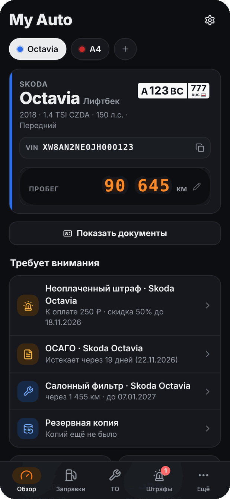
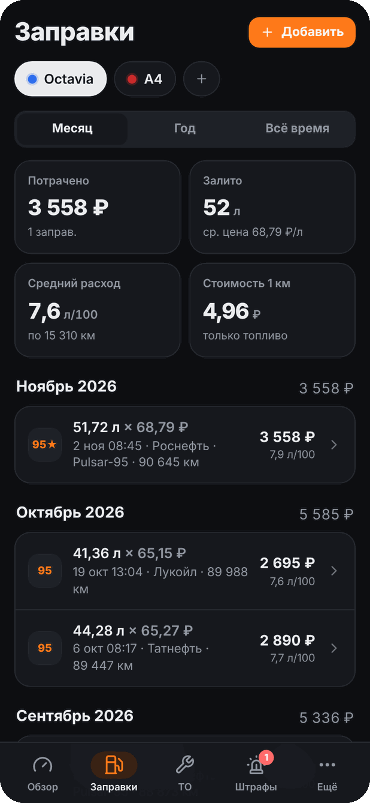
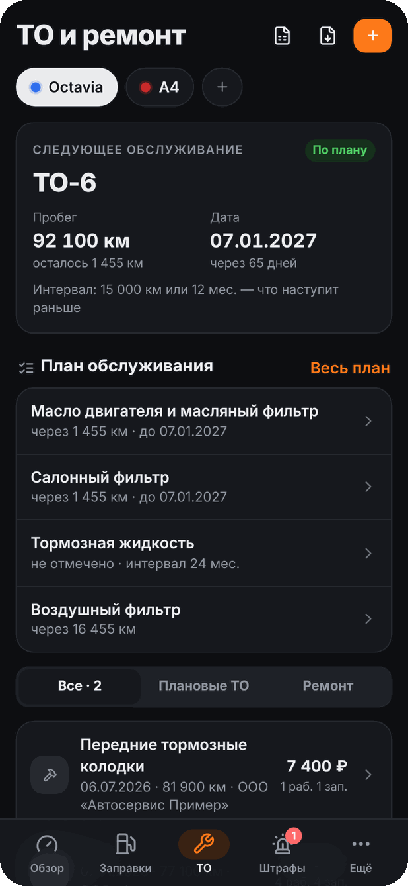
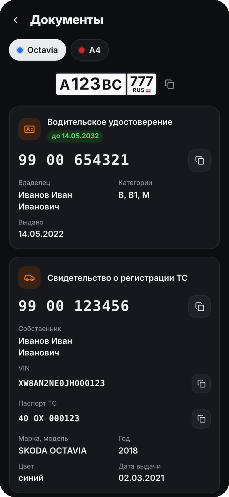
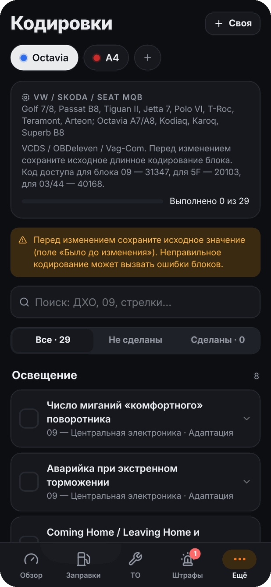
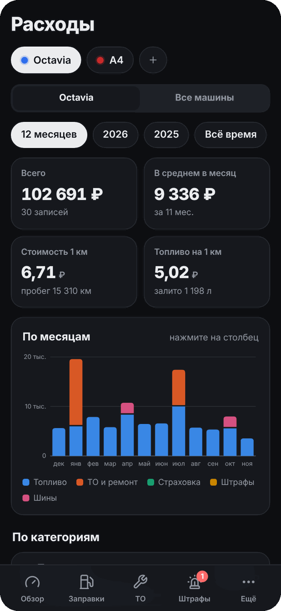
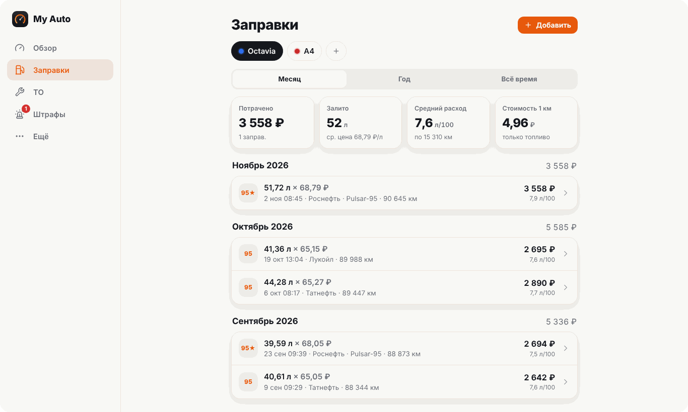

<p align="center">
  
</p>

<h1 align="center">My Auto</h1>

<p align="center">
  Дневник автомобиля: заправки, ТО, документы, штрафы и кодировки в одном приложении.<br>
  Без регистрации и рекламы. Все данные хранятся только на вашем телефоне.
</p>

<p align="center">
  <a href="https://github.com/nikitatos156/MyAuto/releases/latest"></a>
  <a href="LICENSE"></a>
  
</p>

<p align="center">
  <a href="https://github.com/nikitatos156/MyAuto/releases/latest"><b>Скачать для Android</b></a>
  &nbsp;·&nbsp;
  <a href="https://nikitatos156.github.io/MyAuto/"><b>Открыть веб-версию</b></a>
</p>

<table align="center">
  <tr>
    <td></td>
    <td></td>
    <td></td>
  </tr>
  <tr>
    <td></td>
    <td></td>
    <td></td>
  </tr>
</table>

<p align="center"><sub>На скриншотах — вымышленные машины и документы.</sub></p>

## Возможности

| | |
| --- | --- |
| **Заправки** | Чек с камеры, из галереи или PDF из почты сам заполняет литры, цену, сумму, топливо, АЗС и дату; по QR-коду кассового чека дата и сумма берутся точно. Фирменное топливо крупных сетей (ЭКТО, G-Drive, Танеко, Pulsar). Расход по методу «полный бак — полный бак» |
| **ТО и ремонт** | Номер ТО, пробег, работы и запчасти с артикулами, чеки, PDF по одному ТО и по всей истории. Заказ-наряд (PDF или фото) сам заполняет работы и запчасти — с ценами со скидкой, так что сумма сходится с итогом. Импорт истории из Excel/CSV |
| **План обслуживания** | Масло, фильтры, свечи, тормозная жидкость, масло коробки, ГРМ: когда меняли и когда пора, по пробегу и времени |
| **Документы** | СТС, ПТС/ЭПТС, госномер, ВУ, ОСАГО, КАСКО с историей замен. Фото документа заполняет поля (у СТС — все 24 поля обеих сторон). Экран «Показать документы» для остановки: всё на одном экране, номера копируются одним касанием, работает без интернета |
| **Штрафы** | Проверка в один тап по СТС и ВУ (гибдд.рф, Госуслуги), распознавание уведомления, скидка 50% и сроки оплаты |
| **Кодировки** | Библиотека для VW, Audi, Skoda, Seat и BMW с 2010 года (PQ25, PQ35/46, MQB, MLB, MLBevo, F, G) — подбирается по марке, модели и году. Отметки выполнения, исходные значения, свои кодировки, многошаговые дооснащения |
| **Шины** | Комплекты, переобувки с пробегом, пробег каждого комплекта, напоминание о сезонной замене |
| **Расходы** | Стоимость владения по категориям и месяцам, стоимость 1 км, отчёт в PDF и Excel |
| **Напоминания** | ТО, страховка, сроки документов, штрафы со скидкой, резервные копии; виджет на рабочем столе Android |
| **Защита** | Вход по PIN-коду, отпечатку или Face ID |

Новая машина добавляется вручную или по фото СТС — марка, модель, год, VIN и мощность подтянутся сами.

## Установка

**Android.** Скачайте `MyAuto-<версия>.apk` из [последнего релиза](https://github.com/nikitatos156/MyAuto/releases/latest) и откройте файл (при первой установке телефон попросит разрешить установку из браузера). Дальше приложение обновляется само.

**iPhone.** Откройте [веб-версию](https://nikitatos156.github.io/MyAuto/) в Safari → «Поделиться» → «На экран „Домой“». Приложение работает без интернета и обновляется само.

**Компьютер.** [Веб-версия](https://nikitatos156.github.io/MyAuto/) работает в любом современном браузере; в Chrome и Edge её можно установить как приложение (значок в адресной строке).

<p align="center"></p>

## Конфиденциальность

- Данные (машины, документы, чеки, фото) хранятся только на устройстве. Сервера у приложения нет, аккаунт не нужен.
- Распознавание текста (Tesseract) работает прямо на телефоне — фото никуда не отправляются.
- Перенести данные на другой телефон можно файлом резервной копии (Настройки → Резервные копии).
- В интернет приложение ходит только за обновлениями (GitHub) и когда вы сами открываете проверку штрафов.

## Для разработчиков

```bash
npm install
node build.mjs            # сборка в dist/
node build.mjs --serve    # локальный сервер http://localhost:5173
```

Стек: React 19, TypeScript, esbuild, IndexedDB, service worker; Android — Capacitor 8 и [Capgo Updater](https://github.com/Cap-go/capacitor-updater) для обновлений по воздуху.

```
src/
  data/       модель, IndexedDB, расчёты, разбор документов, каталог кодировок
  lib/        сканер, OCR, PDF, бэкапы, уведомления, обновления, мост к Android
  screens/    экраны
  ui/         компоненты
public/       index.html, manifest, service worker, иконки, модели OCR, pdf.js
scripts/      иконки, нативная часть Android (плагин, виджет) и настройка проекта
```

**Сборка и релизы.** GitHub Actions (`.github/workflows/build.yml`) при каждом пуше в `main`:

1. собирает подписанный APK и создаёт релиз `v1.0.<номер сборки>` с файлами `MyAuto-<версия>.apk` и `web-<версия>.zip`;
2. публикует веб-версию в GitHub Pages (Settings → Pages → Source: GitHub Actions).

Приложение на Android смотрит последний релиз через публичный API GitHub. Новая веб-часть (`web-*.zip`, проверяется по SHA-256) ставится через Capgo Updater; если увеличился `native-version.txt` (изменились плагины или настройки Android), приложение предлагает скачать новый APK.

Секреты (Settings → Secrets and variables → Actions):

| Секрет | Значение |
| --- | --- |
| `ANDROID_KEYSTORE_BASE64` | ключ подписи APK в base64 |
| `ANDROID_KEYSTORE_PASSWORD` | пароль ключа |
| `UPDATE_TOKEN` | необязательно: read-only токен, нужен только для приватного форка |

Без ключа подписи собирается только проверочный debug-APK, релиз не создаётся. Для своего форка создайте собственный ключ: APK, подписанный другим ключом, не встанет поверх установленного.

**Распознавание.** Снимки проходят через встроенный сканер (`src/lib/scan.ts`: края листа, перспектива, тени), затем Tesseract WASM с моделями rus + eng в 2–3 воркерах (`src/lib/ocr.ts`). Бланки СТС, ПТС и ВУ распознаются в несколько проходов с голосованием значений (`src/data/ocrText.ts`, `stsParse.ts`, `docParse.ts`); у PDF берётся текстовый слой (`src/lib/pdfImport.ts`).

## Лицензия

Код — [MIT](LICENSE). Сторонние библиотеки, шрифты и модели распознавания распространяются по своим лицензиям — см. [THIRD-PARTY-NOTICES.md](THIRD-PARTY-NOTICES.md).

Кодировки и номера запчастей собраны из открытых источников и даны как ориентир: перед изменением кодирования сохраняйте исходное значение, запчасти сверяйте по VIN.
